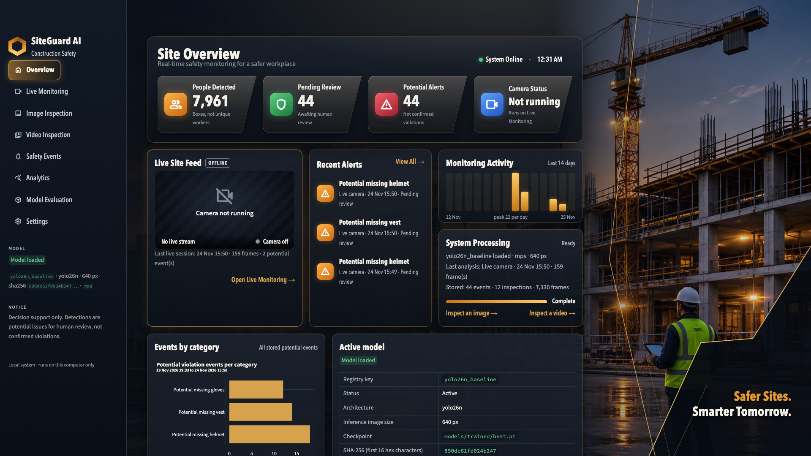
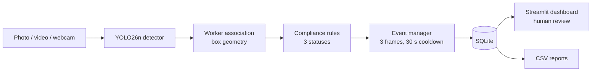
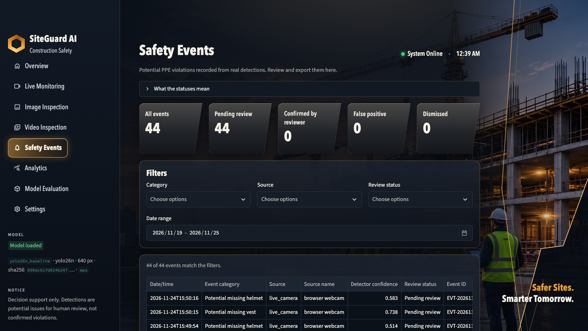

# SiteGuard AI

**AI-assisted PPE monitoring for construction sites that runs entirely on one laptop.**


SiteGuard AI analyses construction-site photos, recorded videos and a live webcam. It detects workers, the protective equipment they wear (hard hat, high-visibility vest, gloves, boots, goggles) and explicit *missing-PPE* cases, links each item to the right worker, and records **potential** violations as safety events for a supervisor to review.

> **Decision support, not a certified safety system.** The model suggests and a person decides. Failing to detect a helmet is never treated as proof that a helmet is missing.



## Highlights

- **12 object classes:** workers (Person), five PPE items, five explicit missing-PPE classes and forklifts.
- **Per-worker checks** for helmet, vest and gloves, using box geometry, with three statuses: potential violation, compliant evidence and uncertain.
- **Event logic that avoids false alarms:** a problem must appear in 3 analysed frames before it becomes an event, and repeats are suppressed for 30 seconds.
- **Human review:** annotated evidence, review statuses (confirmed, false positive, dismissed) and CSV reports.
- **Real-time on a laptop:** 29.8 fps with 0 dropped frames on a recorded webcam replay (MacBook Air M5).
- **Fully local:** no image, video or camera frame leaves the computer.
- **8-page Streamlit dashboard** and **205 automated tests**.

## Results

Model: YOLO26n, fine-tuned for 30 epochs (batch 8, 640 px) in 21 minutes on an Apple M5 (MPS).

**Validation split** (200 images, 2,961 labelled objects):

| Precision | Recall | mAP50 | mAP50-95 |
|---:|---:|---:|---:|
| 0.832 | 0.681 | 0.734 | 0.523 |

At the application's detection threshold of 0.25, precision is 0.884 and recall is 0.745.

**Per class (mAP50):** Person 0.940 · goggles 0.924 · vest 0.887 · helmet 0.825 · forklift 0.807 · gloves 0.793 · boots 0.771 · no_boots 0.748 · no_vest 0.692 · no_helmet 0.652 · no_gloves 0.620 · no_goggle 0.148. Goggles are optional by default, because `no_goggle` is unreliable.

**Speed** (recorded webcam replay of 149 frames, MacBook Air M5): 29.8 fps, 0 frames dropped, 20.3 ms mean and 24.8 ms p95 inference time, within the 33.3 ms budget of a 30 fps camera.

### Bigger-model experiment (not promoted)

A YOLO26m candidate at 896 px ("E3") reached mAP50 0.854 on the same validation set. On a locked test of 160 images (2,480 objects), evaluated once, it scored 0.847 against a pre-registered target of 0.93, and it ran at 23.7 fps, dropping 31 of 149 frames. It failed both gates, so YOLO26n remains the active model. Details: [REPORT-025](experiments/accuracy_improvement/reports/REPORT-025-final-research-decision.md).

## How it works



| Setting | Value |
|---|---|
| Detection confidence / NMS IoU | 0.25 / 0.5 |
| Minimum confidence for a worker (Person box) | 0.40 |
| Minimum confidence for a potential violation (missing-PPE box) | 0.50 |
| Minimum confidence for compliant evidence (PPE box) | 0.40 |
| Required PPE | helmet, vest, gloves |
| Event confirmation / cooldown | 3 analysed frames / 30 s |

All settings are in [configs/settings.yaml](configs/settings.yaml). Architecture details: [docs/ARCHITECTURE.md](docs/ARCHITECTURE.md).

## The dashboard

| Page | What it does |
|---|---|
| Overview | Site summary, recent alerts, monitoring activity and the active model |
| Live Monitoring | Webcam analysis in the browser, with live worker statuses and events |
| Image Inspection | Upload photos; original and annotated images, a compliance card per worker, download |
| Video Inspection | Analyse a video file every Nth frame; annotated H.264 output and its events |
| Safety Events | Filter events, preview evidence, set the review status, export CSV |
| Analytics | Charts from stored data only |
| Model Evaluation | Validation metrics, per-class results, curves and the research comparison |
| Settings | Read-only view of thresholds, model identity, classes and versions |



## Quick start

Developed and tested on macOS with Apple silicon and Python 3.12.

```bash
git clone https://github.com/Junaid0775/SiteGuard-AI.git
cd SiteGuard-AI
python3.12 -m venv .venv
.venv/bin/pip install -r requirements.txt
```

**Model weights and the dataset are not included in this repository.** Download the [Construction-PPE dataset](https://docs.ultralytics.com/datasets/detect/construction-ppe) and place it next to the project as `../construction-ppe/`, or set `SITEGUARD_DATASET_DIR=/path/to/construction-ppe`. Then build the dataset configuration and train the model:

```bash
.venv/bin/python -m src.utils.dataset_tools      # validates the dataset and writes the configuration
.venv/bin/python -m src.training.train           # 30 epochs, batch 8, 640 px; writes models/trained/best.pt
```

Start the dashboard and open http://localhost:8501:

```bash
.venv/bin/streamlit run app.py
```

Use `--server.port 8502` if port 8501 is busy. The webcam works on `http://localhost` after you allow camera access in the browser.

Run the tests:

```bash
.venv/bin/python -m pytest -q
```

The tests that run real inference need the trained model and the dataset.

## Project structure

```
SiteGuard-AI/
├── app.py              Streamlit dashboard (8 pages)
├── configs/            settings.yaml (thresholds, model registry) and dataset.yaml
├── src/
│   ├── detection/      detector, image, video and live-frame processing, annotation
│   ├── compliance/     worker association and compliance rules
│   ├── events/         event manager (deduplication) and SQLite store
│   ├── evaluation/     evaluation and the viewpoint experiment
│   ├── reporting/      CSV reports
│   ├── training/       YOLO26n training
│   └── ui/             dashboard theme and components
├── tests/              pytest suite
├── scripts/            dataset and media helper scripts
├── docs/               architecture, dataset, training, evaluation and reports
├── experiments/        metrics, charts and reports from every experiment
└── presentation/       10-slide presentation deck and speaker notes
```

## Limitations

- **Missing PPE is under-reported.** Missing-PPE recall is below 0.90 for every class (YOLO26n at 0.25: no_helmet 0.615, no_gloves 0.567, no_goggle 0.171), so many real violations are not detected.
- **Real sites are harder.** On the locked test, real-site photos score mAP50 0.592, against 0.951 for generated close-ups.
- **Overhead cameras fail.** A frontal-trained model drops from mAP50-95 0.639 on frontal views to 0.185 on 219 held-out overhead images.
- **Labels need review.** 178 possibly wrong labels were found in a dataset audit and have not been corrected.
- **No identity tracking.** Worker labels are per frame, so counts are detections, not unique workers.
- **Speed figures come from a recorded webcam replay,** not from a physical-camera benchmark.

The absence of events never shows that a site is compliant. A supervisor must review every potential event.

## Documentation

- [docs/ARCHITECTURE.md](docs/ARCHITECTURE.md): system design
- [docs/DATASET.md](docs/DATASET.md): dataset, checksums and audit
- [docs/TRAINING.md](docs/TRAINING.md): training setup and results
- [docs/EVALUATION.md](docs/EVALUATION.md): evaluation and the viewpoint experiment
- [experiments/accuracy_improvement/reports/](experiments/accuracy_improvement/reports/): the bigger-model research programme
- [presentation/](presentation/): the project presentation deck

## Privacy

Camera frames, evidence images, the events database, dataset images and model weights are deliberately kept out of this repository (see [.gitignore](.gitignore)).

## License

The SiteGuard AI code is released under the [MIT License](LICENSE).

SiteGuard AI depends on [Ultralytics YOLO](https://github.com/ultralytics/ultralytics), which is licensed separately under AGPL-3.0. The MIT License covers this repository's own code only. Anyone who distributes SiteGuard AI together with Ultralytics, or offers it as a service, must also follow the AGPL-3.0 terms or hold an Ultralytics Enterprise License.

Dataset: *Ultralytics Construction-PPE Dataset*, Ultralytics team, November 2026, [CC BY 4.0](https://creativecommons.org/licenses/by/4.0/). The dataset is not included in this repository.

## Author

Junaid Ahmad ([Junaid0775](https://github.com/Junaid0775)), 471 Project, November 2026.
