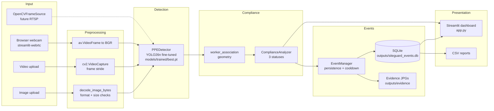
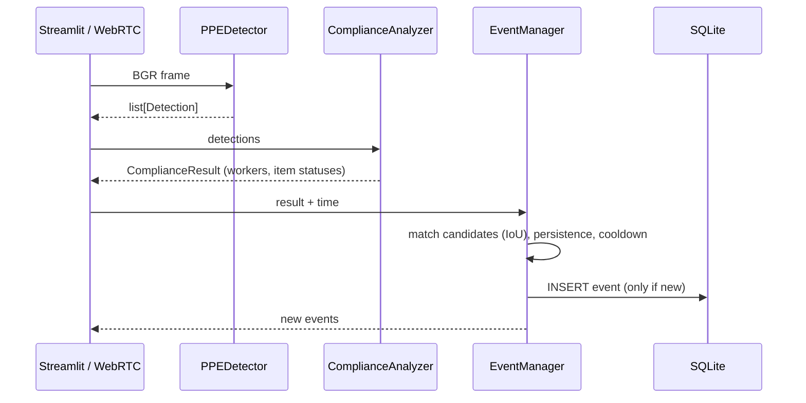

# SiteGuard AI — Architecture

This document explains how the parts of SiteGuard AI fit together. It is written for someone new to the codebase.

## 1. Layers

| Layer | Module | Responsibility |
|---|---|---|
| Input | `app.py`, `src/detection/camera_processor.py` | File uploaders, WebRTC webcam, `OpenCVFrameSource` (camera index or stream URL, for later RTSP use) |
| Preprocessing | `src/detection/image_processor.py`, `video_processor.py` | Validate type/size, decode safely, read video frames, sample every Nth frame. Resizing is done by Ultralytics' letterbox at the configured `imgsz`. |
| Detection | `src/detection/detector.py` | Load `best.pt`, run inference, return `Detection` objects (class name from the checkpoint, confidence, box). Thread-safe (a lock guards `predict`). |
| Compliance | `src/compliance/worker_association.py`, `compliance_analyzer.py` | Link PPE/missing-PPE boxes to workers and decide a status per worker and item. |
| Events | `src/events/event_manager.py`, `event_store.py` | Deduplicate potential violations into events, save evidence, store in SQLite. |
| Analytics | `app.py` (Overview, Analytics pages) | Charts from the `events` and `inspections` tables. |
| Reporting | `src/reporting/report_generator.py` | CSV export with human-readable columns and a disclaimer. |
| Evaluation | `src/evaluation/evaluate.py`, `viewpoint_evaluation.py` | Real validation metrics and the viewpoint experiment. |
| Training | `src/training/train.py` | Reproducible fine-tuning from pretrained weights. |

## 2. Data flow for one frame

## 3. Compliance rules

The detector finds objects independently: a `helmet` box is not linked to any person. The compliance layer links them.

**Association** (`worker_association.py`). For a PPE box *d* and a worker box *p*:

1. Expand *p* by `person_box_margin` (10 %), because helmets and boots often stick out of the person box.
2. `containment = area(d ∩ p') / area(d)` must be at least `min_containment` (0.60).
3. `region factor` = 1.0 when the centre of *d* is in the expected vertical band of the body, otherwise 0.5. The bands are fractions of person height, where 0 is the top of the box: helmet −0.10–0.40, goggles −0.05–0.35, vest 0.10–0.80, gloves 0.10–0.95, boots 0.65–1.10.
4. `centring factor` = 0.8 + 0.2 × (1 − horizontal offset / half width).
5. `score = containment × region × centring`.

The box goes to the worker with the highest score. If the runner-up scores within `ambiguity_margin` (0.15), the box is **ambiguous** and goes to nobody. Each box is used at most once, so one `no_helmet` detection can never alert for two workers.

**Classification** (`compliance_analyzer.py`). For each worker and each required item (default: helmet, vest, gloves):

| Condition | Status |
|---|---|
| A linked `no_<item>` box with confidence ≥ `violation_confidence` (0.50), and no stronger `<item>` box overlapping it (IoU ≥ 0.50) | **Potential violation** |
| The same as above, but contradicted by a stronger overlapping PPE box | Uncertain (conflicting evidence) |
| No qualifying negative box, and a linked `<item>` box with confidence ≥ `evidence_confidence` (0.40) | **Compliant evidence** |
| Anything else, including nothing detected | **Uncertain / insufficient visual evidence** |

Worker overall: *potential violation* if any item is one; *compliant evidence* only if every required item is; otherwise *uncertain*.

Not detecting a helmet is **never** treated as a missing helmet. The head may be hidden, out of frame, too small or missed. Only the explicit `no_*` classes, which the dataset annotators drew on visible body regions, can raise a potential violation.

## 4. Event deduplication

`EventManager` uses box overlap and time. It does not track identities.

- **Persistence.** In video and live mode, a potential violation must appear in `min_consecutive_hits` (3) analysed frames before an event is raised. The frames are matched by category plus worker-box IoU ≥ `match_iou` (0.30). A gap longer than `candidate_timeout_seconds` (3 s) resets the count. Single images need one hit.
- **Cooldown.** After an event, the same category in an overlapping worker region is suppressed for `cooldown_seconds` (30 s). A violation that continues past the cooldown produces one reminder event per cooldown period.
- **Time base.** Video uses video time (`frame_index / fps`). Live mode uses the monotonic wall clock.

## 5. Storage

`outputs/siteguard_events.db` (SQLite) contains:

- `events`: `event_id`, `timestamp`, `source_type`, `source_name`, `category`, `confidence`, `worker_ref`, `worker_box`, `media_time_s`, `evidence_path`, `review_status` (`pending_review` / `confirmed` / `false_positive` / `dismissed`) and `notes`.
- `inspections`: one row per image, video or live session, with frames analysed, Person-box count, per-class detection counts and the settings used.

Raw uploads are not kept. Videos are written to a temporary file for OpenCV and deleted after processing. Only annotated outputs and evidence frames for events are saved.

## 6. Threading

`streamlit-webrtc` calls the frame callback in a worker thread. To make this safe:

- `PPEDetector.detect` holds a lock around `model.predict`.
- `LiveFrameProcessor` and `EventManager` keep their own locks.
- `EventStore` opens a new SQLite connection per call and serialises writes.

The dashboard reads live statistics through `LiveFrameProcessor.snapshot()` inside an auto-refreshing `st.fragment`.

## 7. Adjustments to the suggested folder structure

| Change | Reason |
|---|---|
| Added `src/detection/annotate.py` | Drawing code is shared by the image, video and live paths. |
| Added `src/utils/dataset_tools.py` | Holds dataset validation, the symlink mirror and generated YAMLs, which are needed by training, evaluation and tests. |
| Added `scripts/` | One-off helper scripts (contact sheets for viewpoint labelling, viewpoint CSV builder, test-video builder) that are not part of the app. |
| Added `data/` | Holds generated, non-original data: the mirror, generated YAMLs, viewpoint metadata and the test clip. |
| Added `.streamlit/config.toml` | Theme (light/dark, orange accent) and telemetry off. |
| Added `.ultralytics/` | Keeps Ultralytics' settings and font inside the project. Telemetry (`sync`) is disabled. |
