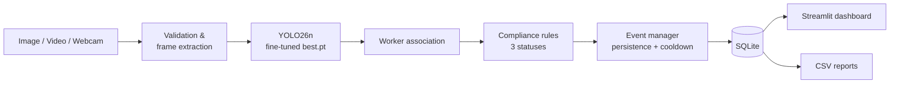

# SiteGuard AI

**Intelligent Real-Time Construction Site PPE Compliance Monitoring System**, an academic computer-vision project.

SiteGuard AI analyses construction-site photographs, recorded videos and a live webcam. It detects workers and PPE (helmets, vests, gloves, boots, goggles), as well as explicit *missing-PPE* cases, and links them to individual workers. It records **potential** violations as reviewable safety events.

> **SiteGuard AI is a decision-support prototype, not a certified safety system.** Its outputs are model-based observations for a supervisor to check. Failing to detect a helmet is *not* treated as proof that a helmet is missing.

---

## 1. Problem statement

Supervisors must check that workers wear the right PPE. Manual inspection is hard when many workers are visible or several camera views must be watched. SiteGuard AI highlights possible PPE problems and keeps annotated evidence, so a human can review them quickly.

## 2. Objectives

1. Detect workers, PPE items and explicit missing-PPE classes (12 classes).
2. Associate detections with individual workers using bounding-box geometry.
3. Classify each worker as *potential violation*, *compliant evidence* or *uncertain*.
4. Record deduplicated events with evidence and review status, and export CSV reports.
5. Provide a dashboard for images, videos and a live camera.
6. Evaluate the model honestly, including a viewpoint generalisation experiment.

## 3. Dataset

**Ultralytics Construction-PPE** (Nov 2026, **CC BY 4.0**): 1,000 images (800 train / 200 val) and 14,863 boxes in 12 classes. The original dataset in `../construction-ppe/` is **never modified**. A checksum baseline proves this (see [docs/DATASET.md](docs/DATASET.md)).

| ID | Class | ID | Class | ID | Class |
|---|---|---|---|---|---|
| 0 | helmet | 4 | goggles | 8 | no_gloves |
| 1 | gloves | 5 | Person | 9 | no_boots |
| 2 | vest | 6 | no_helmet | 10 | forklift |
| 3 | boots | 7 | no_goggle | 11 | no_vest |

Attribution: *Ultralytics Construction-PPE Dataset, Ultralytics team, November 2026, CC BY 4.0* (https://docs.ultralytics.com/datasets/detect/construction-ppe).

## 4. Technology stack

Python 3.12, PyTorch 2.15 (Apple MPS), Ultralytics 8.4.215 (YOLO26n), OpenCV 5.1, Streamlit 1.67, streamlit-webrtc 0.79, NumPy, Pandas, Plotly, PyYAML, SQLite and pytest. Exact versions are in `requirements.txt`.

## 5. System architecture



Details: [docs/ARCHITECTURE.md](docs/ARCHITECTURE.md).

## 6. Folder structure

```
SiteGuard-AI/
├── app.py                     Streamlit dashboard (8 sections)
├── requirements.txt, .gitignore, README.md
├── .streamlit/config.toml     theme (light/dark, orange accent), telemetry off
├── configs/
│   ├── dataset.yaml           corrected, portable dataset config (12 classes)
│   └── settings.yaml          all thresholds and training parameters
├── src/
│   ├── training/train.py
│   ├── detection/             detector, image/video/camera processors, annotate
│   ├── compliance/            worker_association, compliance_analyzer
│   ├── events/                event_manager (dedup), event_store (SQLite)
│   ├── evaluation/            evaluate, viewpoint_evaluation
│   ├── reporting/             report_generator (CSV)
│   └── utils/                 paths, dataset_tools, logging_config
├── scripts/                   contact sheets, viewpoint CSV builder, test-video builder
├── data/                      mirror (symlinks), generated YAMLs, viewpoint metadata, test clip
├── models/pretrained/         yolo26n.pt (COCO-pretrained)
├── models/trained/            best.pt, last.pt, MODEL_SOURCE.json
├── experiments/               training runs, evaluation, viewpoint results
├── outputs/                   events DB, evidence, annotated videos, reports
├── tests/                     pytest suite
└── docs/                      ARCHITECTURE, DATASET, TRAINING, EVALUATION, IMPLEMENTATION_LOG, reports/
```

## 7. Environment setup

```bash
cd "~/Desktop/471 Project/SiteGuard-AI"
uv venv --python 3.12 .venv                     # or: python3.12 -m venv .venv
uv pip install --python .venv/bin/python -r requirements.txt
.venv/bin/python -c "import torch; print('MPS:', torch.backends.mps.is_available())"
```

If a corporate proxy or firewall breaks downloads, retry with `UV_HTTP_TIMEOUT=300`.

## 8. Dataset configuration

```bash
.venv/bin/python -m src.utils.dataset_tools
```

This validates the dataset, builds the symlink mirror `data/dataset_mirror/` and writes `data/generated/dataset_resolved.yaml`. If the dataset is elsewhere, set `SITEGUARD_DATASET_DIR=/path/to/construction-ppe`.

## 9. Training

```bash
.venv/bin/python -m src.training.train            # 30 epochs, batch 8, imgsz 640, MPS
```

The best checkpoint is copied to `models/trained/best.pt`. An existing file is backed up first, never overwritten. Resume an interrupted run with `--resume experiments/<run>/weights/last.pt`. Details: [docs/TRAINING.md](docs/TRAINING.md).

## 10. Model evaluation

```bash
.venv/bin/python -m src.evaluation.evaluate                                  # official val split
.venv/bin/python -m src.evaluation.viewpoint_evaluation prepare              # viewpoint splits
.venv/bin/python -m src.training.train --data data/generated/viewpoint/frontal_train.yaml \
       --name viewpoint_frontal_only --no-promote
.venv/bin/python -m src.evaluation.viewpoint_evaluation evaluate \
       --weights experiments/viewpoint_frontal_only/weights/best.pt
```

Details and results: [docs/EVALUATION.md](docs/EVALUATION.md).

## 11. Running the application

```bash
.venv/bin/streamlit run app.py
```

Open http://localhost:8501. If port 8501 is already used by another app, run `.venv/bin/streamlit run app.py --server.port 8502` and open http://localhost:8502. Navigation is in the sidebar.

- **Image Inspection:** upload one or more JPG/PNG/BMP/WEBP images. The page shows the original and annotated images, a compliance card per worker, the detection table, and a download of the annotated JPG. Potential violations are recorded as events; switch this off with the toggle.
- **Video Inspection:** upload an MP4/MOV/AVI/MKV file, choose *analyse every Nth frame*, then click **Analyse video**. A progress bar shows each frame. The result is an annotated H.264 MP4 (playable and downloadable) with a summary and its events. The raw upload is deleted after processing.
- **Live Monitoring:** press **START** in the camera widget and allow camera access in the browser, then press **STOP** to end. Every Nth frame is analysed. Current detections, worker statuses and new events refresh every second. A potential violation must persist for 3 analysed frames, and repeats are suppressed for 30 s. Use `http://localhost`, because browsers block cameras on non-HTTPS remote addresses. On macOS, allow the browser under *System Settings → Privacy & Security → Camera*. No external STUN/TURN server is contacted.
- **Safety Events:** filter by category, source, review status and date. Preview the evidence frame, set the review status (`pending_review`, `confirmed`, `false_positive`, `dismissed`) with notes, and download a CSV report.
- **Analytics / Overview:** counts and Plotly charts from stored data only. "Person detections" are Person boxes at or above the worker-confidence threshold, summed over frames. They are **not** unique workers. No compliance percentage is shown, because no validated denominator exists without identity tracking.
- **Model Evaluation:** real validation metrics, per-class results, confusion matrix, training curves and the viewpoint experiment.
- **Settings / About:** thresholds, required PPE, cooldown, persistence, video/live sampling and model information. **Save as defaults** writes `configs/settings.yaml`.

## 12. Tests

```bash
.venv/bin/python -m pytest -q
```

The tests cover dataset paths, class mapping, annotation parsing, invalid images, model loading, detection format, worker association, compliance classification, event deduplication, SQLite review, CSV reports, real image and video inference, the live-frame processor and all 8 dashboard pages (Streamlit AppTest).

## 13. Results (real runs, 2026-11-19)

**Training:** YOLO26n fine-tuned for 30 epochs in 21.2 min on an Apple M5 (MPS), batch 8, imgsz 640. Best epoch 25.

**Standard validation** (official val split, 200 images, 2,961 boxes):

| Precision | Recall | mAP50 | mAP50-95 |
|---:|---:|---:|---:|
| 0.832 | 0.681 | 0.734 | 0.523 |

Strong classes: Person (mAP50 0.940), goggles (0.924) and vest (0.887). The missing-PPE classes are precise (0.84–0.92) but have lower recall (0.55–0.67). `no_goggle` is unreliable (mAP50 0.148), so goggles are not required by default. Per-class table: [docs/EVALUATION.md](docs/EVALUATION.md).

**Viewpoint generalisation experiment** (a separate model trained only on the 527 frontal train images; mAP50-95):

| Test group (never trained on) | Images | mAP50-95 | Frontal − group |
|---|---:|---:|---:|
| Frontal (val) | 112 | 0.639 | — |
| Side (held out) | 116 | 0.678 | −0.040 |
| Overhead (held out) | 219 | 0.185 | +0.454 |

The model generalises to **side** views at eye level, but **not** to **overhead / elevated CCTV-style** views. Overhead images in this dataset also show smaller workers in wider scenes, so the drop mixes viewpoint with object size. Training on all viewpoints raises overhead val from 0.227 to 0.309, which still leaves a large gap. Full analysis, controls and caveats: [docs/EVALUATION.md §5](docs/EVALUATION.md).

**Pipeline:** on the 270-frame test clip (stride 5), 54 frames were analysed in 2.7 s. 16 events were recorded and 105 repeat detections suppressed. The output is an H.264 MP4.

**Tests:** 64 passed (`pytest -q`).

## 13.2 Implementation status

| Feature | Status |
|---|---|
| Dataset validation, portable config, symlink mirror (original untouched, checksum-verified) | Implemented and tested |
| YOLO26n transfer learning (MPS), best.pt / last.pt, resume after interruption | Implemented and tested |
| Detector (class names from the checkpoint), configurable confidence and resolution | Implemented and tested |
| Worker association and 3-status compliance rules | Implemented and tested |
| Event persistence, cooldown, evidence images, SQLite, review status, CSV export | Implemented and tested |
| Image inspection (single and multiple) | Implemented and tested (AppTest with real images) |
| Video inspection (stride, progress, H.264 output) | Implemented and tested (generated test clip) |
| Live webcam (streamlit-webrtc) | Implemented. Frame processing tested automatically; **browser camera needs a manual check** |
| Analytics, Overview, Model Evaluation pages from real data | Implemented and tested |
| Standard validation and viewpoint experiment | Run, with results above |
| RTSP / CCTV input | Future work (`OpenCVFrameSource` placeholder exists) |
| Worker identity tracking, unique-worker counts, compliance rate | Future work |

## 14. Limitations

- **Decision support only.** Events are *potential* issues. False positives and missed detections happen.
- **No identity tracking.** Worker labels (W1, W2…) are per frame, numbered left to right. Deduplication uses box overlap plus a cooldown, so a worker who walks far away may be reported again.
- **Absence is not evidence.** Without an explicit `no_*` detection, a worker is *uncertain*, never *non-compliant*.
- **Dataset.** 1,000 images, partly generated imagery (per the dataset README). Accuracy on real CCTV feeds from a specific site is unknown. Rare classes (`no_goggle`, `forklift`, `no_vest`) have few examples.
- **Viewpoint labels** were assigned by an AI assistant from thumbnails and should be spot-checked. Viewpoint is confounded with image style (see docs/DATASET.md §6).
- **Test video.** No real site video was available. The video test clip is a slideshow built from validation images (`data/test_media/`).
- **Live webcam.** The processing path is tested automatically with real frames. The browser camera itself needs a manual check, because it requires a person to grant permission.
- `objc … implemented in both cv2 and av` warnings appear on macOS, because OpenCV and PyAV both bundle FFmpeg. They have no observed effect.

## 15. Future improvements

- Multi-object tracking (e.g. ByteTrack) for persistent worker IDs, unique-worker counts and a defensible compliance rate.
- An RTSP/CCTV input, using `OpenCVFrameSource`, which already accepts stream URLs.
- Site-specific fine-tuning on real footage, plus a properly balanced viewpoint dataset.
- Per-zone PPE rules (for example, goggles only near cutting areas) and notification hooks.
- User accounts and an audit trail for event reviews.
